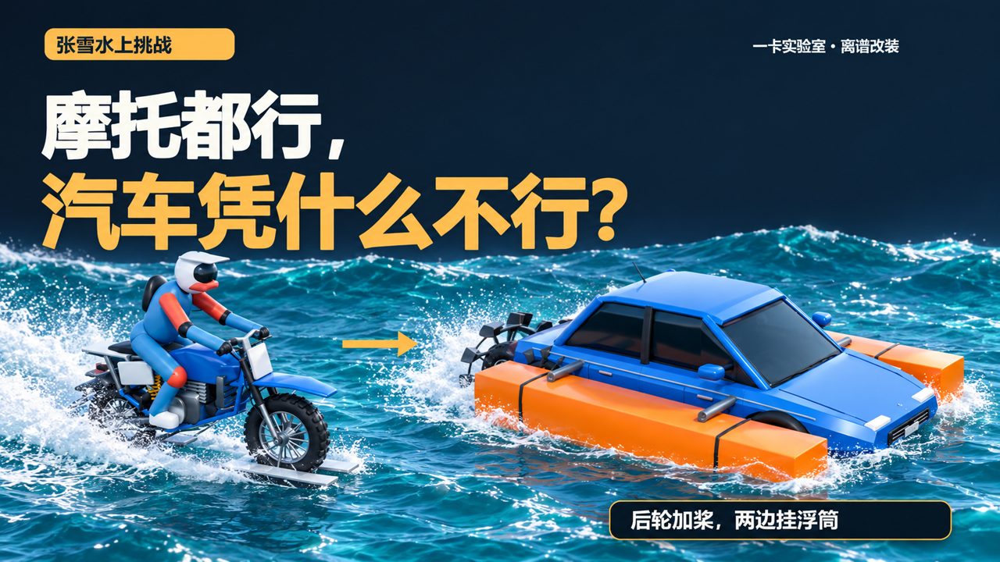

# 张雪的摩托能跑水上，那我的汽车呢？

[观看B站成片](https://www.bilibili.com/video/BV1ykHF6FENx/) · [下载模型与实验数据](https://github.com/holdonyb/yika-lab-zhangxue-water/releases/tag/v2.1)

一卡实验室 · 离谱改装。用 MuJoCo 计算车辆运动与水动力外力，再在 Blender 中回放保存的轨迹。



从摩托后轮桨叶开始，依次尝试汽车后轮加桨、两侧浮筒和四块滑板，比较平水、迎浪、横浪、长涌、减重、断动力与不同入水初速。

## 下载与目录

- [模型与实验数据](https://github.com/holdonyb/yika-lab-zhangxue-water/releases/tag/v2.1)：两份修正后的可编辑 Blender 场景、95 组运行记录，以及本期采用的原创模型片段。解压到仓库根目录。
- `physics/`：MuJoCo 动力学、水动力外力、几何浮力与滑行模型。
- `visuals/`：车辆建模、桨叶杯形、轨迹回放和渲染脚本。
- `research/`：工况清单、结果、检查脚本与原理资料。
- `script_final.txt`、`timeline.json`：成片文稿与20章时间线。

95组包含33组基线、7组原模型入水诊断、44组滑行分支和11组补测，保留成功、失败及诊断轨迹。每组包含参数、MuJoCo XML、NPZ状态、CSV分账和结果。

## 本期发现

同176 kW动力预算下，纯后轮桨叶在0/5/8/10/15/20 m/s六档初速中均下潜；四滑板方案从0/5/8 m/s释放未起滑，以10/15 m/s初速入水平水时维持30秒。起滑能力与跑起来后的承重，需要分别检查。

桨叶使用宽横向浅杯，最低点朝车后拨水。金色单片和慢放用于看清方向，常速镜头采用实际子帧曝光。两份可编辑模型对应2026-10-27修订版。

这些是本仓库参数下的模型结果。水动力采用外力近似；杯口凹凸面流场、前后板尾流互扰及实车标定另列在[方法说明](research/PLANING_METHOD_REVIEW.md)。

## 运行一个独立工况

Python依赖见`requirements.txt`；Blender 5.1与FFmpeg单独安装。先解压Release数据，再在仓库根目录执行：

```powershell
py -3.11 -m venv .venv
& ./.venv/Scripts/python.exe -m pip install -r requirements.txt
& ./.venv/Scripts/python.exe ./physics/hydro.py --cases bike_flat --duration 2 --suffix _local_demo
```

生成新的`physics/runs/bike_flat_local_demo/`。渲染已保存的正式轨迹：

```powershell
blender -b -t 4 -P visuals/render_scene.py -- --run physics/runs/bike_flat_final --preview --camera paddle --start-time 2 --out preview/bike_paddle --save-blend
```

Release中的`.blend`是可编辑静态场景；动态画面由轨迹和渲染脚本重建。源码、数据与原制作文件保持一致，历史回执中的制作机路径仅用于来源记录。

## 制作分工

本期从选题到上传由 **Astra通过Codex主导**：策划、研究、实验设计、MuJoCo代码、Blender模型与渲染、数据检查、脚本统筹、剪辑、封面、章节和发布。

**Gemini 4 Argon（Vertex AI）**负责整稿审改及音画检查；**Gemini 3.8 Flash TTS**负责旁白配音。其他配乐与音效为原创合成。

## 资料来源

影片引用的新闻与实车资料链接见[sources/assets.json](sources/assets.json)及[三款水陆汽车对照](research/AMPHIBIOUS_COMPARISON.md)。公开下载提供原创模型和实验数据，新闻原片、第三方照片与论文PDF由其原始来源提供。
