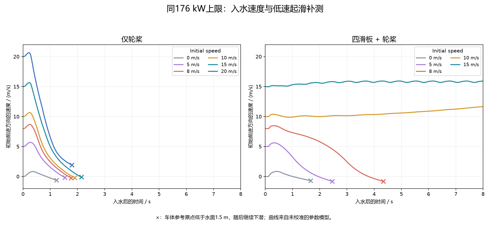

# 入水速度、动力与低速起滑补测

2026-10-27。针对“为什么只选5 m/s，能否15 m/s，以及是否应该多测”的追加要求，保留原实验并新增9组自由入水和2组半时间步复算。

**5 m/s不是速度上限。当前模型中，高速入水维持滑行与从低速加速起滑，是两件需要分别测试的事。**

后轮桨叶负责推进，前后板面可提供动态支撑，分工与摩托方案相近。仍需计算浸没位置，因为它决定桨叶、板面和车身哪些部分接水，以及受力和力矩作用在哪里；但不能只用静浮排水量不足，就判定高速运行一定失败。本轮按实际接水状态同时计算静浮力、板面动态力、轮桨力和阻力，再求整车运动。

两套方案均保持每后轮1040 N·m、88 kW上限（合计176 kW），只给轮轴扭矩，不强制保持车速。初始纵倾0°，最低构件离平水面2 cm，随后自由六自由度运动。纯桨叶1424 kg，四滑板1468.1408 kg，差值包括装置质量。功率上限敏感性固定车重，不代表已完成实车动力改装。

0 m/s是从水面上方释放且驱动，不含岸坡、道路或托架。失败组均触发车体参考原点低于−3.5 m的停止条件；下表时间是该停止时刻，不是开始下沉的精确时刻。

| 方案 | 初速 m/s | 步长 ms | 运行至停止 s | 峰值实际功率 kW | 结果 |
|---|---:|---:|---:|---:|---|
| 仅轮桨 | 0 | 1 | 1.959 | 47.3 | 下潜停止 |
| 仅轮桨 | 5 | 1 | 2.292 | 74.2 | 下潜停止 |
| 仅轮桨 | 8 | 1 | 2.500 | 90.2 | 下潜停止 |
| 四滑板+轮桨 | 0 | 1 | 2.688 | 86.5 | 下潜停止 |
| 四滑板+轮桨 | 5 | 1 | 3.355 | 117.4 | 下潜停止 |
| 四滑板+轮桨 | 8 | 1 | 5.250 | 136.5 | 下潜停止 |
| 仅轮桨 | 10 | 1 | 2.646 | 100.9 | 下潜停止 |
| 仅轮桨 | 15 | 1 | 2.917 | 127.6 | 下潜停止 |
| 仅轮桨 | 20 | 1 | 2.834 | 155.1 | 下潜停止 |
| 仅轮桨 | 15 | 0.5 | 2.917 | 127.6 | 下潜停止 |
| 四滑板+轮桨 | 8 | 0.5 | 5.250 | 136.5 | 下潜停止 |

实际功率由当时轮速和扭矩共同决定，列出176 kW预算不代表每时每刻输出176 kW。全部工况数据、功率、力分项、姿态及能量残差均保留，不能把下潜过程末段当作稳态。

## 半时间步对照

- lowentry_20261027_paddles_v15_p176：步长1→0.5 ms，停止时刻变化+0.0000 s，峰值前向速度变化-0.0007 m/s；原始能量残差183.36→91.27 J；两组均下潜。
- lowentry_20261027_four_skis_v8_p176：步长1→0.5 ms，停止时刻变化-0.0000 s，峰值前向速度变化-0.0000 m/s；原始能量残差85.36→42.34 J；两组均下潜。

## 与已有高速运行放在一起看

纯轮桨在同176 kW预算、初速0/5/8/10/15/20 m/s下均未维持水面运行。四滑板从0/5/8 m/s释放也未起滑；已有10和15 m/s入水的30秒组在当前对称平水模型内维持动支撑，末段约15.8 m/s。由此只能说初态会影响起滑过程，尚未确定准确起滑速度，也未验证岸边入水过程。

这些新增结果补足了“只比较不同速度时动力不同”和“只看高速入水成功”的缺口。影片原有15 m/s入水的限定结果仍成立；不能扩写成从静止自启动、全天候稳定或实车改装可行。

现有模型的杯桨仍是双面法向阻力近似，未解析凹凸面差异、喷溅和自由水面反馈；滑板前后尾流也未求解。增加同一模型的测试量能检查参数与数值表现，不能代替模型标定或实车试验。

## 核对资料

- [全部新增数据和检查](entry_supplement_checks.json)
- [原44组滑行实验](CAR_PLANING_RESULTS.md)
- [仰望U8、Panther、Amphicar对照](AMPHIBIOUS_COMPARISON.md)
- [桨叶形状与旋转检查](PADDLE_DIRECTION_REPAIR.md)

11组参数分别在low_speed_entry_manifest.json、matched_power_entry_manifest.json、entry_halfstep_manifest.json登记，原始轨迹位于physics/runs/lowentry_20261027_*。
